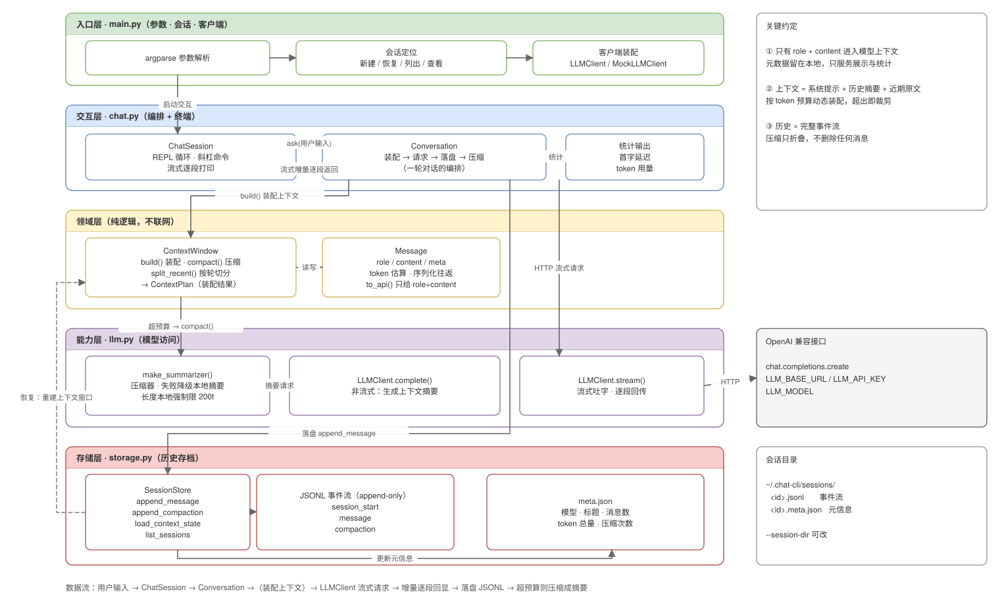

# chat_cli · 命令行聊天助手

多轮对话、流式输出、历史存档的最小可用实现。

**重点在两件事上：消息结构（一条消息由什么组成）和上下文管理（哪些消息会被送进模型）。**

---

## 架构图



| 文件 | 用途 |
| --- | --- |
| `architecture.drawio` | 原生可编辑图（draw.io / diagrams.net 打开） |
| `architecture.svg` | 矢量图，浏览器直接看 |
| `architecture.png` | 位图，方便贴文档 |

图分五层：入口层 `main.py` → 交互层 `chat.py` → 领域层（`context.py` + `messages.py`，
纯逻辑不联网）→ 能力层 `llm.py` → 存储层 `storage.py`，右侧是外部模型接口。
两条虚线是本示例最关键的两条路径：**流式增量逐段返回**和**恢复时重建上下文窗口**。

> `.drawio` 是可编辑的源头；`svg` / `png` 由同一份布局数据渲染，改图建议直接改 `.drawio`。

---

## 快速开始

**必须在 `Demos/examples` 目录下运行**（包在 `examples` 下，Python 靠当前目录找包）：

```bash
cd Demos/examples

# 推荐：uv 会自动带上 Demos 项目的依赖，并加载 Demos/.env
uv run --project .. python -m chat_cli

# 离线演示：不联网、不消耗 token，用假客户端跑通多轮 / 流式 / 落盘 / 压缩全流程
uv run --project .. python -m chat_cli --mock

# 小预算，方便立刻观察上下文压缩
uv run --project .. python -m chat_cli --mock --max-context-tokens 300 --keep-recent-turns 1
```

裸解释器也行，但只够跑离线模式（`--mock` 不需要任何第三方依赖）：

```bash
cd Demos/examples && python3 -m chat_cli --mock
```

从任意目录运行，用 `PYTHONPATH` 指到包所在的目录：

```bash
PYTHONPATH=Demos/examples uv run --project Demos python -m chat_cli
```

### 常见报错

| 报错 | 原因 | 解决 |
| --- | --- | --- |
| `No module named chat_cli` | 不在 `Demos/examples` 目录下 | `cd Demos/examples`，或加 `PYTHONPATH=Demos/examples` |
| `ModuleNotFoundError: No module named 'dotenv'` | 用裸 `python3` 跑，缺依赖 | 用 `uv run --project .. python -m chat_cli`；离线模式可用 `python3 -m chat_cli --mock` |
| `ModuleNotFoundError: No module named 'openai'` | 同上 | 同上，或先 `cd Demos && uv sync` |
| `没有找到 API Key` | 没加载到 `Demos/.env` | 用 `uv run --project ..` 运行，或手动 `export LLM_API_KEY=...` |

交互中的命令：

| 命令 | 作用 |
| --- | --- |
| `/help` | 帮助 |
| `/history [n]` | 查看本会话完整历史（不受上下文压缩影响） |
| `/context` | **查看本轮送给模型的上下文构成与 token 用量** |
| `/compact` | 手动触发一次上下文压缩 |
| `/sessions` | 列出本机保存的所有会话 |
| `/clear` | 清空当前上下文（磁盘历史保留） |
| `/exit` | 退出（也可直接输入 `exit` / `quit`） |

其它 CLI 参数：

```bash
python -m chat_cli --list                      # 列出会话
python -m chat_cli --show 20261026-101500-a1b2 # 打印某个会话的全部消息
python -m chat_cli --resume 20261026-101500-a1b2  # 恢复会话继续聊
python -m chat_cli --system-file prompt.txt    # 用文件当系统提示词
python -m chat_cli --no-stream                 # 关掉流式，一次性返回
python -m chat_cli --session-dir /path/to/dir  # 自定义会话存放目录
```

自检（不依赖 pytest，验证消息结构与上下文的核心不变量）：

```bash
python -m chat_cli.selftest
```

---

## 目录结构

```
chat_cli/
├── __init__.py     包入口
├── __main__.py     支持 python -m chat_cli
├── messages.py     ① 消息结构
├── context.py      ② 上下文管理
├── storage.py      ③ 历史持久化
├── llm.py          ④ 模型调用（流式 + 摘要）
├── chat.py         ⑤ 对话编排与终端交互
├── main.py         ⑥ 命令行入口
└── selftest.py     自检脚本
```

---

## ① 消息结构

一条消息 = **role（角色）** + **content（内容）** + **元数据（本地信息）**。

```python
@dataclass
class Message:
    role: str                                  # system / user / assistant
    content: str                               # 正文
    id: str                                    # 本地唯一标识
    created_at: str                            # 创建时间
    tokens: int                                # 本地估算的 token 数
    meta: dict                                 # 扩展位：model / finish_reason / 摘要标记…
```

关键约定：

1. **只有 `role` 和 `content` 会进入模型上下文。**
   这是"历史"和"上下文"的分界线——历史可以有任意元数据，
   `Message.to_api()` 只输出模型真正需要的两个字段：

   ```python
   def to_api(self) -> dict[str, str]:
       return {"role": self.role, "content": self.content}
   ```

2. **消息是事实记录**，落盘用 `to_dict()`，回放用 `from_dict()`，不做二次加工。
   序列化往返完全无损（见自检第 1 组）。

3. **token 是本地估算**，只服务于上下文预算控制：

   ```python
   CJK 字符  → 1 字 ≈ 1 token（启发式估算，不保证高估）
   其它字符  → 4 字符 ≈ 1 token
   ```

   真实计费以服务端返回的 `usage` 为准。这个估算决定了"哪些消息会被丢弃"，
   实际 tokenizer、消息封装和输出 token 均可能使真实用量不同，需预留余量。

4. **派生消息有标记。** 上下文压缩产生的摘要也是一条 `Message`，
   但 `meta.synthetic = True`，可以在 `/history` 里和原始对话区分开。

---

## ② 上下文管理（核心）

上下文窗口是一个**分层结构**，越靠前越不可丢弃：

```
┌──────────────────────────────────────────────┐
│ 1. 系统提示        常驻，永远保留              │  ← 不可丢
├──────────────────────────────────────────────┤
│ 2. 历史摘要        压缩态：旧对话折叠成一段摘要  │  ← 可截断
├──────────────────────────────────────────────┤
│ 3. 近期原文        近期态：最近 N 轮的原始消息   │  ← 可丢弃旧的
├──────────────────────────────────────────────┤
│ 4. 当前输入        本轮用户消息                │  ← 永远保留
└──────────────────────────────────────────────┘
```

### 装配规则（`ContextWindow.build()`）

保留优先级从高到低：

1. **系统提示** —— 为最新消息预留空间后按需截断，始终在第一位。
2. **最新一条消息** —— 永远保留（哪怕它自己就超预算）。
3. **历史摘要** —— 占用剩余预算；放不下就**截断摘要正文**而不是整条丢弃
   （半截摘要也比没有摘要有用）。
4. **其余近期消息** —— 从新到旧依次装入，放不下的丢弃。

装配结果通常不超过本地估算预算；若最新消息与系统消息开销之和超预算，仍会保留最新消息并超出。实际请求还需为模型回复预留空间。
每轮对话结束后还会打印两个不同的数字：

```
本轮发送 139t · 下轮携带 ~500/500t (100%) · 已压缩 2 条 → 摘要 33t
```

- `本轮发送`：这次请求**实际**带进模型的内容。
- `下轮携带`：按预算重新装配后，下一轮会带上的内容（会先裁剪再统计）。

这两个数不一样，正是"上下文是动态装配出来的"最直观的证据。

### 压缩策略（`ContextWindow.compact()`）

当工作记忆用量超过预算的 75% 时自动触发：

1. 按"轮"（一条用户消息 + 后续助手消息）切分，保留最近 N 轮原文。
2. 更早的消息交给压缩器，生成一段不超过 200 token 的摘要。
3. 新摘要由旧摘要和本次折叠内容生成；压缩有损，重要细节仍可能丢失。
4. 压缩事件写进会话文件，**完整历史一条不删**。

压缩器优先调用模型生成高质量摘要；模型不可用时降级为
`naive_summary()`（每条消息截取开头 60 字），保证压缩流程不中断。
摘要长度本地再截一次——模型不一定遵守"不超过 200 字"的要求。

### 观察压缩

```bash
python -m chat_cli --mock --max-context-tokens 300 --keep-recent-turns 1
```

对话中输入 `/context`，可以看到摘要已经出现在上下文里：

```
上下文装配结果
  预算      : 300 token
  已用      : 146 token (48.7%)
  工作记忆  : 124 token（未裁剪）

  1. [系统] 你是一个命令行对话助手。回答简洁、结构清晰，默认使用中文。…
  2. [系统] 【历史对话摘要】以下是被折叠的更早对话，仅供参考： （离线摘要）…
  3. [用户] 第三轮内容
  4. [助手] （离线演示）收到 6 条上下文消息，最近一轮输入是「第三轮内容」…
```

而 `/history` 仍然能看到全部原始消息——**上下文是算出来的，历史是存下来的**。

---

## ③ 历史存储

`~/.chat-cli/sessions/`（可用 `--session-dir` 改）下每个会话两个文件：

```
20261026-101500-a1b2.jsonl        事件流（append-only）
20261026-101500-a1b2.meta.json    会话元信息
```

### 为什么用 JSONL

- **追加写**：进程被 kill 也不会丢掉已经写入的历史。
- **逐行可读**：`cat` / `grep` 直接看。
- **易流式处理**。

### 事件类型

| 类型 | 含义 |
| --- | --- |
| `session_start` | 会话创建，记录模型和系统提示词 |
| `message` | 一条消息（完整 `Message.to_dict()`） |
| `compaction` | 一次压缩：摘要 + 被折叠掉的消息 id |
| `clear` | 清空工作记忆的边界，完整历史仍保留 |

`compaction` 事件记录了被折叠消息的 id，所以 `--resume` 时能**精确还原**
压缩后的工作记忆，而不是靠猜测；清空边界也会被回放。

消息是**先落盘再请求**：即使模型调用失败，用户这句话也已经进了历史。

### 恢复会话

```bash
python -m chat_cli --resume 20261026-101500-a1b2
```

回放事件流 → 还原摘要 + 近期消息 → 继续聊，历史继续追加到同一个文件。

---

## ④ 模型调用

```python
for delta in client.stream(plan.api_messages):   # 流式：逐段吐字
    ...
reply = client.complete(api_messages)            # 非流式：给摘要用
```

走 OpenAI 兼容接口（`LLM_BASE_URL` / `LLM_API_KEY` / `LLM_MODEL`），
和仓库里其它示例保持一致。`--mock` 会换成 `MockLLMClient`，
接口完全相同但不联网，方便演示和自测。

---

## 可扩展的方向

- **多模型 / 多 provider**：改 `llm.py`，加一个同接口的 client 即可，
  上层的上下文逻辑完全不用动。
- **工具调用**：`Conversation.ask()` 已经是"装配 → 请求 → 落盘"的循环，
  在中间插入工具执行即可（参考同目录的 `agent5.py`）。
- **更好的压缩**：`make_summarizer()` 换成结构化摘要（按主题分条），
  或换成滑动窗口 + 向量检索召回。
- **多端同步**：可基于事件流设计同步，但还需要并发控制、冲突处理和访问权限。
