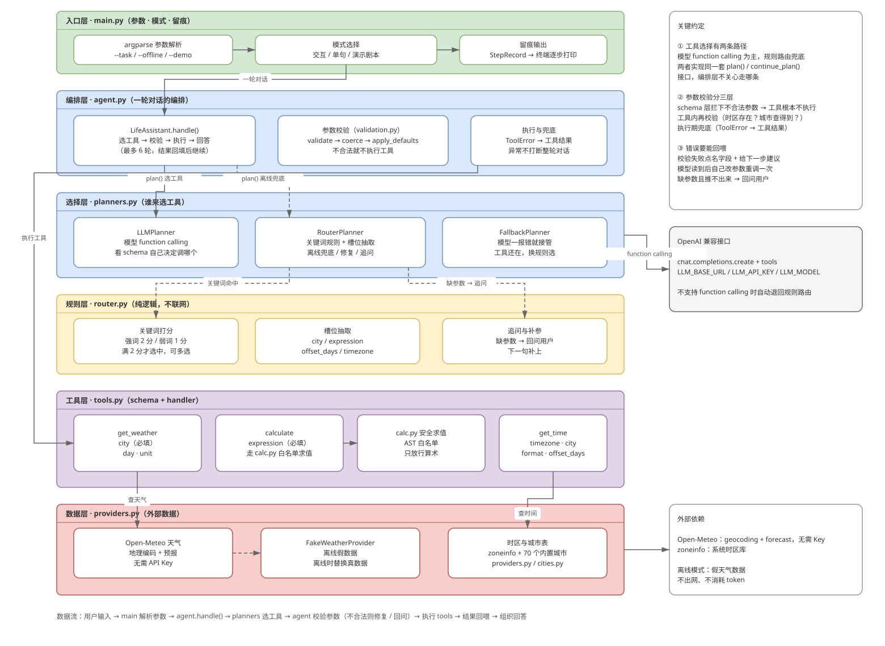

# life_assistant · 生活助手 Agent

三个工具的最小 Agent：**天气、计算、时间**。

**重点不在工具本身，在两件事上：工具选择**（谁来决定调哪个工具、调几个）
**和参数校验**（参数不合法时怎么拦、怎么修、怎么回问用户）。

---

## 架构图



| 文件 | 用途 |
| --- | --- |
| `architecture.drawio` | 原生可编辑图（draw.io / diagrams.net 打开） |
| `architecture.svg` | 矢量图，浏览器直接看 |
| `architecture.png` | 位图，方便贴文档 |

图分六层：`main.py`（入口）→ `agent.py`（编排）→ `planners.py`（选择）
→ `router.py`（规则）→ `tools.py`（工具）→ `providers.py`（数据），
右侧是模型接口与关键约定。两条虚线是本示例最关键的两条路径：
**离线路径接管模型**和**校验失败回喂**。

> `.drawio` 是可编辑的源头；`svg` / `png` 由同一份布局数据渲染，改图建议直接改 `.drawio`。

---

## 快速开始

**必须在 `Demos/examples` 目录下运行**（包在 `examples` 下，Python 靠当前目录找包）：

```bash
cd Demos/examples

# 离线演示：不联网、不消耗 token，规则路由 + 假天气数据，11 个场景全跑一遍
uv run --project .. python -m life_assistant --demo

# 离线对话：自己问，自己看决策过程
uv run --project .. python -m life_assistant --offline

# 真实对话：模型来选工具（需要模型接口）
uv run --project .. python -m life_assistant

# 只跑一句话
uv run --project .. python -m life_assistant --task "北京今天天气怎么样"
```

裸解释器也能跑离线模式（不依赖任何第三方包）：

```bash
cd Demos/examples && python3 -m life_assistant --demo
```

从任意目录运行，用 `PYTHONPATH` 指到包所在的目录：

```bash
PYTHONPATH=Demos/examples uv run --project Demos python -m life_assistant --demo
```

自检（不依赖 pytest，不联网）：

```bash
cd Demos/examples && python3 -m life_assistant.selftest
```

### 常见报错

| 报错 | 原因 | 解决 |
| --- | --- | --- |
| `No module named life_assistant` | 不在 `Demos/examples` 目录下 | `cd Demos/examples`，或加 `PYTHONPATH=Demos/examples` |
| `ModuleNotFoundError: No module named 'openai'` | 用裸 `python3` 跑，缺依赖 | 用 `uv run --project ..` 运行；离线模式 `python3 -m life_assistant --demo` 不需要依赖 |
| `没有找到 API Key` | 没加载到 `Demos/.env` | 用 `uv run --project ..` 运行，或手动 `export LLM_API_KEY=...` |
| 天气查不到 / 超时 | Open-Meteo 接口不可达 | 加 `--offline` 用假数据，或换网络重试 |

对话中的命令：`/help` 帮助、`/tools` 工具清单、`/exit` 退出。

---

## 目录结构

```
life_assistant/
├── __init__.py     包入口
├── __main__.py     支持 python -m life_assistant
├── main.py         ① 命令行入口：交互 / 单句 / 演示剧本
├── agent.py        ② 主循环：选择 → 校验 → 修复 → 执行 → 回答
├── planners.py     ③ 两种选工具的策略：模型 function calling / 规则路由
├── router.py       ④ 规则路由：关键词打分 + 槽位抽取
├── tools.py        ⑤ 三个工具：schema + handler
├── validation.py   ⑥ 轻量 JSON Schema 校验器
├── providers.py    ⑦ 外部数据源：天气接口 / 时区 / 离线假数据
├── calc.py         ⑧ 安全表达式求值
├── cities.py       ⑨ 内置城市表
├── models.py       跨模块流转的数据结构
└── selftest.py     自检脚本
```

分层是单向的：`main → agent → planners → tools → providers`，
`validation` 被 agent 和 tools 共用，`router` 只在离线路径上生效。

---

## 一、工具选择

### 两条路径，同一套接口

| 路径 | 谁来选 | 什么时候用 |
| --- | --- | --- |
| `LLMPlanner` | 模型（OpenAI 兼容接口的 function calling） | 默认路径 |
| `RouterPlanner` | 关键词规则 | 离线模式；模型接口不可用时自动接管 |

两条路径实现同一个 `plan()` / `continue_plan()` 接口，
所以 `agent.py` 不关心当前跑的是哪条——**这正是"工具选择"可以分层做的原因**。

模型路径的关键在于：工具的 schema 直接发给模型，由模型决定
"调不调、调哪个、调几个、参数怎么填"。模型返回的 `arguments` 是 JSON 字符串，
原样保留在 `ToolCall.raw_arguments` 里——解析失败时，这是排查的唯一线索。

规则路径用来兜底，也用来演示"没有模型时工具选择长什么样"：

- 关键词分**强 / 弱**两档：强词记 2 分，弱词记 1 分，**满 2 分才算选中**。
  这样"现在北京天气怎么样"里的"现在"（弱词 1 分）不会把时间工具勾出来，
  而"算一下"（强词 2 分）会稳稳命中计算工具。
- 强词命中 ≥ 2 分的工具**可以同时选中多个**：
  "北京天气怎么样，顺便算一下 3*4" → 两个工具都调。
- 分数不够时一个都不选，直接说明能力边界，不硬凑。

槽位抽取也在规则路径里：

| 槽位 | 抽取方式 | 例 |
| --- | --- | --- |
| `city` | 内置城市表 → 引号内容 → "在XX"句式 | "北京今天天气怎么样" → `北京` |
| `expression` | 中文运算符 → 常规算式 | "帮我算 12 乘以 8" → `12*8` |
| `offset_days` | 昨天/今天/明天/后天/N 天后 | "三天后是哪天" → `3` |
| `timezone` | 固定别名 → 城市表 | "北京时间" → `Asia/Shanghai` |

---

## 二、参数校验

参数校验分三层，**每一层拦的是不同的问题**：

```
模型给出 arguments
      │
      ▼
① schema 校验 ─── 不过 → 能安全修就修一次，修不好 ↓
      │                        （数字字符串 → 数字、枚举忽略大小写、去空格）
      ▼
② 工具内部再校验 ─ 不过 → 报错（如时区不存在、城市查不到）
      │                        │
      ▼                        ▼
③ 执行成功 ←───────────────┘
```

**schema 层**（`validation.py`）支持这些规则：

| 规则 | 例子 | 错误码 |
| --- | --- | --- |
| 必填参数 | `get_weather` 少了 `city` | `missing` |
| 类型 | `city` 传了数字 | `type` |
| 枚举 | `day` 传了 `"weekend"` | `enum` |
| 数值范围 | `offset_days` 传了 `9999` | `range` |
| 长度 | `expression` 传了空串 | `length` |
| 多余参数 | 传了 schema 里没有的 `temp` | `unknown` |

校验失败时工具**根本不会被执行**——脏数据进不去。

### 错误怎么回给模型

错误不是一句"参数错了"，而是**点名字段 + 给出可执行的下一步**：

```
- day: 只能是 today/tomorrow 之一，实际是 'weekend'（建议：改用 today/tomorrow 中的一个）
```

这段文本会作为 `tool` 消息回喂给模型，模型读到之后自己改参数重调一次。
整条链路由 `selftest.py` 第 7 组覆盖：第一次参数填错 → 被拦下 → 错误回喂 →
改对再调 → 通过 → 拿到结果。

### 参数缺失时回问用户

规则路径下，缺参数会走"追问"而不是硬猜：

```
你 › 天气怎么样
  · [选工具] get_weather() ✓
  · [校验参数] get_weather ✗ · - city: 缺少必填参数 city（建议：补上 city）
  · [追问] 信息不足 ✓ · 请问要查哪个城市的天气？例如「北京」。

你 › 北京
  · [选工具] get_weather(city='北京') ✓
  · [校验参数] get_weather ✓ · 通过
  · [执行工具] get_weather ✓ · 北京今天阴，11.4℃，…
```

补参只在"这句话自己不像一个新问题"时才生效——
否则用户说"算一下"会被误当成对上一轮天气追问的回答。

### 计算工具的安全边界

`expression` 过了 schema 校验也只是一串字符串，里面装的是不是表达式、
会不会变成代码执行，得在工具内部再挡一道。`calc.py` 用
`ast.parse(mode="eval")` 解析后**只遍历白名单节点**：

- 允许：数字常量、四则运算、取模、幂、`sqrt/abs/round/min/max/floor/ceil`、`pi/e/tau`
- 拒绝：属性访问、导入、函数定义、关键字参数、其它一切
- 另外限制：表达式长度 ≤ 200、嵌套 ≤ 20 层、指数 ≤ 100、结果绝对值 ≤ 1e15

`__import__('os').system('ls')`、`().__class__` 都在自检里被验证会失败。

---

## 三、三个工具

| 工具 | 参数 | 校验点 |
| --- | --- | --- |
| `get_weather` | `city`（必填）、`day`（today/tomorrow）、`unit`（celsius/fahrenheit） | 城市名非空；枚举取值 |
| `calculate` | `expression`（必填） | 非空、长度 ≤ 200、只允许白名单语法 |
| `get_time` | `timezone`、`city`、`format`（5 种）、`offset_days`（-365~365） | 整数类型、范围、枚举；时区名在执行时校验 |

天气走 **Open-Meteo** 公开接口，不需要 API Key：

- 地理编码 `https://geocoding-api.open-meteo.com/v1/search?name=...`
- 预报 `https://api.open-meteo.com/v1/forecast?latitude=..&longitude=..`

离线模式换成 `FakeWeatherProvider`：同一个城市同一天永远得到同样的结果，
所以自检可以断言具体数值，演示也不受网络影响。

---

## 四、输出长什么样

每一步都留痕，终端上能直接看到"为什么选了这个工具""参数为什么被拦下来"：

```
你 › 北京今天天气怎么样
  · [选工具] get_weather(city='北京', day='today', unit='celsius') ✓ · 查询某个城市今天或明天的天气…
  · [校验参数] get_weather ✓ · 通过
  · [执行工具] get_weather ✓ · 北京今天阴，11.4℃，体感 9.2℃，2.7℃~14.1℃，湿度 65%，风速 6.4 km/h
北京今天天气阴，温度11.4℃，体感温度9.2℃，湿度65%，风速6.4 km/h。
```

留痕结构是 `StepRecord`（阶段 / 标题 / 成功与否 / 细节），
`--quiet` 可以只留回答。

---

## 五、模型不可用怎么办

`FallbackPlanner` 会在模型接口报错时自动切到规则路由，并在 stderr 上说明原因：

```
[提示] 模型接口不可用，已切换到离线规则路由（APIStatusError: ...）
```

三个工具还在，规则路由照样能把天气、计算、时间答出来——
只是工具选择从"模型说了算"变成"规则说了算"。

---

## 可扩展的方向

- **更多工具**：在 `tools.py` 加一个 `Tool`（schema + handler），
  两条选工具的路径都会自动带上它。
- **更严的校验**：把 `validation.py` 换成完整的 JSON Schema 库，
  现在的子集只覆盖了本示例用到的规则。
- **工具结果结构化**：`ToolResult.data` 已经带了结构化数据，
  可以让模型基于它生成更结构化的回答。
- **多轮记忆**：`LLMPlanner` 已经在维护完整对话历史，
  再接上 `chat_cli` 的上下文压缩就能处理长会话。
