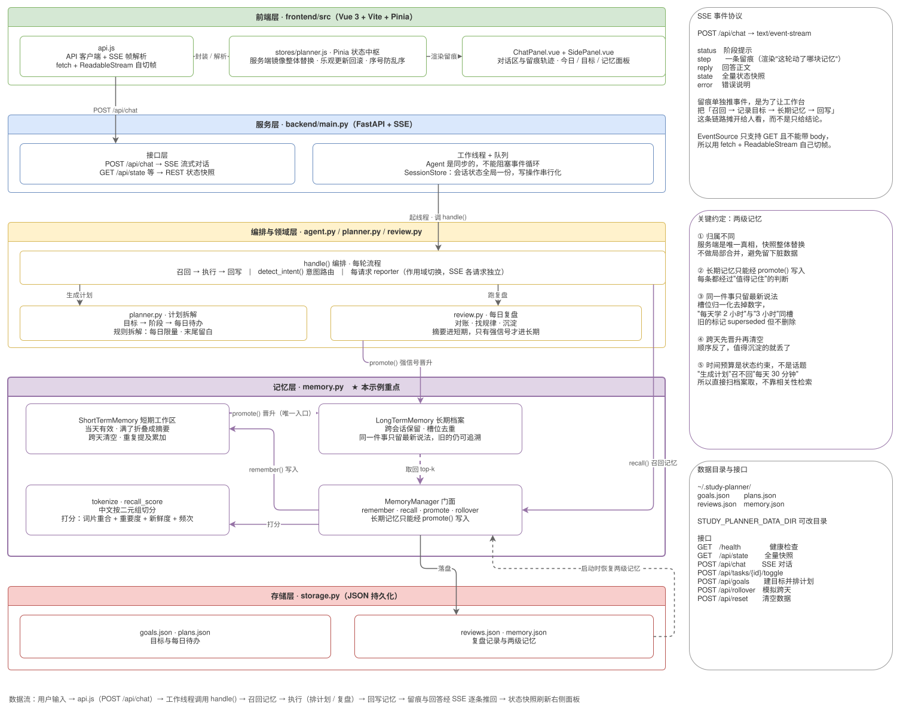

# study_planner · 学习规划师

记录目标、生成计划、每日复盘。

**重点在两级记忆**：短期记忆是当天的工作区，长期记忆是跨会话的档案。
这个示例想讲清楚的是——Agent 怎么"记住"东西，
以及**记在哪、什么时候忘、什么时候值得升级**。

工作台接的是**真实大模型**（OpenAI 兼容接口，配置见 `Demos/.env`）：
模型决定这一轮要做什么、要记什么，再把结果讲给你听。
记忆内核仍然是代码，所以"什么值得记住""预算从哪来"这些约定不会被模型绕过去。

## 记忆系统改造规划

当前版本仍是示例实现。面向个人单机长期使用的改造规划见：

- [记忆系统技术方案](../../../study_planner-记忆系统-技术方案.md)
- [分阶段实施计划](../../../docs/superpowers/plans/2026-11-03-study-planner-memory.md)

两份文档均为待评审方案，尚未实施。

---

## 两级记忆

```
        用户输入
           │
    ┌──────┴──────┐
    ▼             ▼
 短期记忆        长期记忆
 (工作区)         (档案)
    │             ▲
    │  跨天晋升    │
    └─────────────┘

短期：当天有效 · 满了折叠成摘要 · 跨天清空
长期：跨会话保留 · 同一件事只留最新说法 · 按相关度召回
```

### 短期记忆（`ShortTermMemory`）

当天的水��台：刚说过的话、今天的任务、当天的临时想法。

- **容量有限**：默认 24 条。满了不丢弃，而是把最旧的一批**折叠成一条摘要**——
  摘要本身也是一条记忆条目，还能被后续召回命中。
  这和 `chat_cli` 的上下文压缩是同一个思路：丢原文，留语义。
- **跨天清空**：工作区是"今天的"，过了一天就该收工。
- **提及计数**：同一件事在工作区里反复被提起，次数会累加——这是它够格晋升的依据。

### 长期记忆（`LongTermMemory`）

跨天、跨会话存在的档案。**只能通过晋升写入**，不能直接写。

- **槽位机制**：同一件事只保留最新说法。
  用户说"每天能学 2 小时"，又说"改成 3 小时"——后者占用同一个槽位，
  前者标记为 `superseded` 但**不删除**，追溯时还能看到它曾经是什么。
  槽位归一化时会去掉数字，否则每次改预算都会变成一条新记忆，档案会被碎片撑爆。
- **召回打分**：`词片重合 × 3 + 重要度 + 新鲜度 + 使用次数`。
  被取代的条目不参与召回。
- **淘汰**：超过容量时按"重要度 + 提及次数 + 新鲜度"淘汰最不重要的。
  目标、里程碑、被取代的条目不参与淘汰。

### 两者之间怎么连

| 方向 | 机制 | 触发条件 |
| --- | --- | --- |
| 短期 → 长期 | `promote()` | 复盘产生强信号；跨天时被提过 ≥2 次或重要度 ≥4 |
| 长期 → 短期 | `recall()` | 每轮对话开头，按相关度取回 top-k |

**晋升是唯一的写入口**。这样做的意义是：长期记忆里的每一条
都经过了"值得记住"的判断，而不是把所有说过的话都堆进去。

### 一个容易踩的坑

时间预算（"我每天只有 30 分钟"）**不能靠召回来找**。
召回是按词片相关度匹配的，而"生成计划"这四个字跟"每天只能学 30 分钟"
没有任何重合，相关性检索根本召不回来。

预算是**状态约束**而不是话题，得直接扫档案取。
这也是长期记忆区别于"关键词搜索"的地方：它保存的是持续生效的前提条件。

```python
# agent.py
for item in self.memory.long.items:          # ← 扫档案，不是召回
    if item.category != CATEGORY_PREFERENCE:
        continue
    ...
```

---

## 快速开始

命令行入口是**规则模式**（不联网，行为可预测）；
接真实大模型的是下面的前端工作台。

**必须在 `Demos/examples` 目录下运行**（包在 `examples` 下）：

```bash
cd Demos/examples

# 交互模式
uv run --project .. python -m study_planner.backend

# 只跑一句话
uv run --project .. python -m study_planner.backend --task "我想学 Python 数据分析"

# 指定数据目录（默认 ~/.study-planner）
uv run --project .. python -m study_planner.backend --data-dir ./tmp-study
```

裸解释器也能跑（不依赖任何第三方包）：

```bash
cd Demos/examples && python3 -m study_planner --task "我想学 Python 数据分析"
```

---

## 能说什么

| 输入 | 行为 |
| --- | --- |
| `我想学 Python 数据分析` | 记录目标 → 直接进长期记忆并钉住 |
| `我每天只有 30 分钟` | 识别时间预算 → 晋升到长期记忆 |
| `生成计划` | 按目标排计划，**按记忆里的预算排** |
| `今天完成了一项` | 标记今天的下一件事完成 |
| `复盘` | 对账 + 找规律 + 强信号沉淀到长期 |
| `我的进度` | 查进度，并召回相关记忆 |

斜杠命令：

```
/help            显示帮助
/memory          查看两级记忆统计（逐条列出长期档案）
/recall 关键词    看召回结果和打分
/today           今天的待办
/rollover        模拟跨天：清空短期记忆，沉淀到长期
/exit            退出
```

---

## 走一遍看看

每轮对话都会打印"这轮动了哪块记忆"。用 `--data-dir` 指向临时目录，
可以边看边试而不污染真实记录。

**第一步，记目标**——它直接进长期记忆并钉住，不随当天工作区清空：

```console
$ uv run --project .. python -m study_planner.backend --data-dir ./tmp-study --task "我想学 Python 数据分析"
  · [召回] 记忆检索 ✓ · 无命中
  · [记录目标] Python 数据分析 ✓ · g-e8096634c0
  · [长期记忆] 目标已入库 ✓ · 目标钉住，不随工作区清空
  · [回写] 记忆写入 ✓ · 长期 +1 条
记下了：Python 数据分析
要我现在生成一份学习计划吗？
```

**第二步，说出时间预算**——预算是长期约束，被单独识别并记进档案：

```console
$ uv run --project .. python -m study_planner.backend --data-dir ./tmp-study --task "我每天只有 30 分钟"
  · [闲聊] 已记录 ✓ · 写入短期记忆
  · [长期记忆] 时间预算已记下 ✓ · 每天 30 分钟
  · [回写] 记忆写入 ✓ · 短期 +1 条、长期 +1 条
```

**第三步，排计划**——注意排期依据写的是"长期记忆"而不是默认值：

```console
$ uv run --project .. python -m study_planner.backend --data-dir ./tmp-study --task "生成计划"
  · [生成计划] Python 数据分析 ✓ · 每日 30 分钟（长期记忆：每天可学习时间：30 分钟）
  · [排期依据] 长期记忆：每天可学习时间：30 分钟 ✓ · 每日 30 分钟
  · [回写] 记忆写入 ✓ · 短期 +1 条
目标拆成 4 个阶段，14 条日任务：
```

同样这个目标，**说了预算之后是 14 条，不说就是 28 条**。
长期记忆不是把旧话复述一遍，是直接改变新计划怎么排。

**第四步，看记忆内部状态**——交互模式下用 `/memory` 和 `/recall`：

```
/memory        长期档案逐条列出，被取代的用 → 标出
/recall 注意力  看召回结果和每条的打分
/rollover      模拟跨天：短期工作区清空，够格的结论晋升到长期
```

---

## 自检

```bash
cd Demos/examples
uv run --project .. python -m study_planner.backend.selftest
```

112 项检查，覆盖记忆的行为约定与模型模式：

| 分组 | 验的是什么 |
| --- | --- |
| 分词与匹配 | 中文二元组、词序无关 |
| 短期折叠 | 超容量折叠成摘要而非丢弃 |
| 提及计数 | 重复写入不新增条目 |
| 长期槽位 | 同一件事只留最新说法，旧的仍可追溯 |
| 强化 | 反复提到 → 重要度上升，不塞成两条 |
| 召回排序 | 相关度打分、召回即计数 |
| 晋升与跨天 | **先晋升再清空**，顺序不能反 |
| 持久化 | 落盘读回一致 |
| 计划生成 | 阶段、每日限量、留白、过期兜底 |
| 每日复盘 | 对账、找规律、摘要进短期、强信号进长期 |
| 端到端 | 记目标 → 排计划 → 完成 → 复盘 → 查询 → 落盘 |
| 时间预算 | 捕获、影响排期、变更时槽位取代 |
| 目标去重 | 重复记录更新而非追加，重复排计划不叠加待办 |

---

## 前端工作台

FastAPI + Vue 3 + SSE。把规划师变成一个可以看见"记忆在动"的工作台。

```
Demos/examples/study_planner/
├── backend/          全部 Python（FastAPI 服务 + 领域内核 + 命令行）
│   ├── main.py       SSE 对话流 + 状态快照接口
│   ├── cli.py        命令行入口（python -m study_planner.backend，规则模式）
│   ├── llm.py        模型调用层：结构化决策 + 流式回复
│   ├── memory.py     两级记忆内核
│   ├── agent.py      编排：路由 → 召回 → 执行 → 回写
│   ├── planner.py    目标 → 阶段 → 每日待办
│   ├── review.py     每日复盘
│   ├── storage.py    JSON 持久化
│   ├── models.py     数据结构
│   ├── selftest.py   核心自检（112 项）
│   └── selftest_api.py 接口自检（52 项）
└── frontend/         Vue 3 + Vite + Pinia
    ├── src/
    │   ├── api.js            API 客户端（含 SSE 帧解析）
    │   ├── stores/planner.js Pinia 状态中枢
    │   ├── App.vue           工作台外壳
    │   └── components/
    │       ├── ChatPanel.vue  对话 + 留痕轨迹
    │       └── SidePanel.vue  今日 / 目标 / 记忆面板
    └── vite.config.js
```

### 跑起来

两个终端：

```bash
# 终端 1：后端
cd Demos
uv run uvicorn examples.study_planner.backend.main:app --reload --port 8000

# 终端 2：前端
cd Demos/examples/study_planner/frontend
npm install
npm run dev
```

打开 http://localhost:5173。

开发时前端走 **Vite 代理**（`/api` → 后端），前后端同源，
不用管端口号也不碰 CORS。后端端口改了的话：

```bash
VITE_API_BASE=http://127.0.0.1:9000 npm run dev
```

数据默认存 `~/.study-planner`，可以用环境变量改：

```bash
STUDY_PLANNER_DATA_DIR=/tmp/study-scratch uv run uvicorn ...
```

### SSE 事件流

`POST /api/chat` 返回 `text/event-stream`，事件依次是：

| 事件 | 载荷 | 前端拿它做什么 |
| --- | --- | --- |
| `status` | 阶段提示 | 显示"正在召回记忆…" |
| `step` | 单条留痕 | 实时渲染"这轮动了哪块记忆" |
| `delta` | 文本增量 | 逐字显示模型回复（带光标） |
| `reply` | 完整正文 | 定稿显示，覆盖已流式显示的内容 |
| `state` | 全量快照 | 刷新右侧各面板 |
| `error` | 错误说明 | 显示错误条 + 重试 |

`delta` 只负责"逐字往外冒"的体感，`reply` 才是完整正文。
前端收到 `reply` 时用完整文本覆盖已流式显示的内容——
中间万一丢过一段增量，最终显示也不会错。

**为什么留痕要单独推。** 只推最终答案的话，用户只看到"计划已生成"，
不知道背后发生了什么。把 `step` 推出去，工作台就能把
"召回 → 记录目标 → 长期记忆 → 回写"这条链路摊开给人看——
这是本示例最想让人看到的东西。

**为什么不用 EventSource。** EventSource 只支持 GET 且不能带 body，
而聊天请求要 POST 一段文本。所以用 `fetch` 拿 ReadableStream，
自己按 SSE 规范切帧（`api.js` 的 `parseSSE`）。

### 状态管理

Pinia store 回答的核心问题是：**哪些状态归服务端，哪些归前端**。

| 归属 | 内容 | 同步方式 |
| --- | --- | --- |
| 服务端 | `goals` / `items` / `reviews` / `memory` | 后端是唯一真相，收到快照**整体替换** |
| 前端 | `messages` / `streaming` / `error` | 只存在于这个页面，刷新即弃 |

三处容易写错的地方，store 里专门处理了：

**1. 乐观更新要能回滚。** 勾选待办时先翻转本地状态、立刻响应界面，
但请求失败必须把状态改回去。否则界面显示"已完成"、实际没完成，
用户再点一次就点不动了。

**2. 流式请求可能乱序返回。** 快速连发两条消息时，先发的请求可能后到。
用请求序号丢弃过期响应，避免旧回复覆盖新回复。

**3. 快照整体替换而不是合并。** 后端推来的 `state` 是全量快照。
局部合并（只更新 `items` 保留 `goals`）在后端同时改了多个集合时会留下脏数据。

派生状态（今日待办、进度、长期记忆的有效/被取代分组）一律用 `computed`，
不在 state 里存冗余副本。

### 后端接口

| 方法 | 路径 | 用途 |
| --- | --- | --- |
| GET | `/health` | 健康检查 |
| GET | `/api/state` | 全量状态快照 |
| POST | `/api/chat` | **SSE 流式对话** |
| POST | `/api/tasks/{id}/toggle` | 切换待办完成状态 |
| POST | `/api/goals` | 创建目标并排计划 |
| POST | `/api/rollover` | 模拟跨天 |
| POST | `/api/reset` | 清空全部数据 |

所有写操作都串行化（进程内一把锁）：目标、待办、记忆是**全局状态**，
不是每个连接一份，两个并发请求同时改记忆会让条数对不上。

### 接口自检

```bash
cd Demos/examples
uv run --project .. python -m study_planner.backend.selftest_api
```

52 项检查，覆盖 SSE 事件序列（含 delta 增量）、状态快照、预算影响排期、任务勾选、
跨天滚动、参数校验。用 FastAPI 的 `TestClient`，不占端口、不联网。

---

## 架构图



图分六层，自上而下就是一次请求的走向：
前端层 → 服务层 → 模型层 → 编排与领域层 → 记忆层 → 存储层。
模型层是可选层——配了 `LLM_API_KEY` 才有它，没有就走规则模式。
右侧四个说明面板分别讲 SSE 事件协议、两级记忆的关键约定、数据目录与接口、两种模式。
记忆层是本示例的重点，用粗边框标了出来。

| 文件 | 用途 |
| --- | --- |
| `architecture.drawio` | 原生可编辑图（draw.io / diagrams.net 打开），改图改这个 |
| `architecture.svg` | 矢量图，浏览器直接看；内嵌了图元 XML，能在 draw.io 里继续编辑 |
| `architecture.png` | 位图，方便贴文档 |

SVG 里的文字是纯 SVG 文本，不依赖 `foreignObject`，在任意渲染器里都能正常显示。

---

## 模型模式

工作台（`backend/main.py`）接的是**真实大模型**，走 OpenAI 兼容接口：

```bash
# Demos/.env 里配好这三个变量即可
LLM_BASE_URL=https://api.openai.com/v1
LLM_API_KEY=sk-...
LLM_MODEL=gpt-4o-mini
```

没配 `LLM_API_KEY` 时服务照常起，只是退回规则模式（回复由模板生成）。
`GET /health` 会报当前是 `model` 还是 `rule`。

### 一轮对话分两步

```
用户输入
  │
  ├─ ① 召回：代码从两级记忆里取相关内容          ← 代码
  │
  ├─ ② 决策：模型看状态 + 记忆 + 这句话，         ← 模型
  │          给出结构化 JSON（做什么 + 记什么）
  │
  ├─ ③ 执行：代码把决策落到状态上                 ← 代码
  │          写目标 / 排计划 / 标完成 / 跑复盘 / 写记忆
  │
  ├─ ④ 回写：值得长期保留的经 promote() 进档案    ← 代码
  │
  └─ ⑤ 表达：模型把"这轮发生了什么"讲给用户听     ← 模型
             逐段吐字，SSE 推给前端
```

**为什么拆成"模型想、代码做"两步。** 模型只负责决策和表达，
改状态仍然由代码执行。这样做有三个好处：

- **状态永远是真的。** 留痕来自代码执行的每一步，不会出现模型说改了、实际没改。
- **约束绕不过去。** 长期记忆只能经 `promote()` 写入；排期超出时间预算会被代码裁掉。
  模型说"每天 30 分钟"就一定按 30 分钟排。
- **模型挂了服务还能用。** 决策调用失败会自动退回规则模式，留痕里写明"决策调用失败"。

### 模型能决定什么

| 动作 | 模型给什么 | 代码负责什么 |
| --- | --- | --- |
| `record_goal` | 标题、截止日期、标签 | 去重（同名同天是更新不是追加）、钉进长期档案 |
| `generate_plan` | 每日任务清单 | 按时间预算裁剪、按日期校验、写成待办 |
| `record_done` | 要标记哪件事 | 真的把它标完成、进度重算 |
| `review` | 亮点、卡点、下一步 | 完成率、时长这些**数据**由代码算，不让模型编 |
| `query` | — | 直接渲染当前进度和召回的记忆 |
| `answer` | — | 纯对话，不改状态 |

模型还能给出 `memory` 条目（写什么、算不算值得长期保留），
但**写不写、往哪写由代码定**：进长期档案只能走 `promote()`。

### 几个兜底

模型偶尔会犯迷糊，代码这边有几处专门兜底：

- **把时间预算当成目标。**「我每天只有 30 分钟」被记成目标时，
  代码会把它改判成偏好类记忆，不让预算躲在目标列表里。
- **换个说法说预算。** 槽位是按"去掉数字的主题"算的，
  模型说"每天只有 30 分钟"、规则说"每天可学习时间：30 分钟"，
  不归一化就会占两个槽位，档案里堆出两条互相矛盾的预算。
  所以偏好类记忆在写入前会统一成同一句式。
- **模型给的计划一条都用不了**（日期不对、标题为空），
  自动退回模板重排一份，并在留痕里写明"模型计划不可用"，不假装是模型排的。
- **回复替代码吹牛。** 模型偶尔会说"我帮你把任务挪到明天了"，
  而它这轮其实没做。提示词里明确要求：没做的就说没做。

### 命令行为什么还是规则模式

`python -m study_planner.backend` **不联网**，走的是关键字判意图 + 模板拆解那条路。
它存在的意义是"不依赖模型也能把记忆内核跑通"，
也方便对照看两种模式的差别。工作台才是接模型的那一面。

---

## 文件

| 文件 | 用途 |
| --- | --- |
| `backend/models.py` | 数据结构：目标 / 待办 / 复盘 / 记忆条目 |
| `backend/memory.py` | **两级记忆内核**：折叠、槽位、召回、强化、晋升 |
| `backend/planner.py` | 目标 → 阶段 → 每日待办（规则拆解） |
| `backend/review.py` | 每日复盘：对账、找规律、沉淀 |
| `backend/agent.py` | 编排：路由 → 召回 → 执行 → 回写；模型模式下先问模型再执行 |
| `backend/llm.py` | 模型调用层：结构化决策（`complete_json`）+ 流式回复（`stream`） |
| `backend/storage.py` | JSON 持久化 |
| `backend/cli.py` | 命令行入口（`python -m study_planner.backend`） |
| `backend/main.py` | FastAPI 服务：SSE + 状态接口 |
| `backend/selftest.py` | 核心自检（112 项） |
| `backend/selftest_api.py` | 接口自检（52 项） |
| `frontend/src/stores/planner.js` | Pinia 状态中枢 |
| `frontend/src/api.js` | API 客户端 + SSE 帧解析 |
| `architecture.drawio` | 架构图源文件 |

---

## 几个设计取舍

**模型决策、代码执行。** 模型决定"做什么、记什么"，代码负责"真的做"。
计划内容、阶段名、回复措辞交给模型；但"每天排多少分钟""什么能进长期档案"
这些硬约束留在代码里——模型绕不过去，服务也不会因为模型抽风就不可用。

**规则拆解作为兜底而不是主路径。** 模板 + 日期分配那套逻辑没删，
它现在的角色是：模型给的计划不可用时兜底，以及命令行入口的实现。
所以"行为可预测、可测试"这条老规矩依然成立，只是不再是唯一的那条路。

**中文按二元组切分。** 中文不分词，切单字召回过宽。
二元组（"注意力" → "注意"、"意力"）精度够用，且不需要引入分词依赖。

**留痕要如实。** 排期依据会明确写出是"长期记忆读到的"还是"默认值"，
写错来源等于给自己制造一个假记忆——所以这两种情况在留痕里是分开标注的。

**复盘摘要进短期，强信号进长期。** 不是每次复盘都值得往档案里塞东西。
完成了几条、花了多少分钟属于当天的事；连续低完成率、
反复卡在同一件事、目标逾期才值得长期保留。
