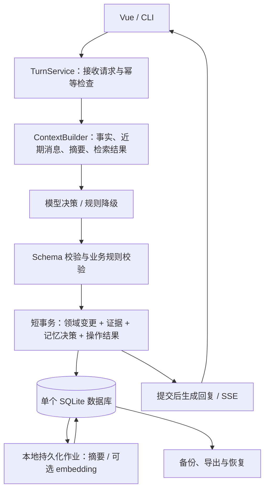

# study_planner 记忆系统生产化改造方案

- 日期：2026-11-03
- 模式：增量改造；状态：P0/P1 已实施并完成离线验收，P2 语义检索未启用（2026-11-04）
- 用户已确认：个人长期使用，本地或单机部署。
- 代码基线：`feature/study-planner`，`6916eca`。
- 本文中的表、类型、接口及参数，除明确标为“已有”外，均为**拟新增或拟修改**。
- 实施清单：[实施计划](docs/superpowers/plans/2026-11-03-study-planner-memory.md)。

## 1. 改造目标与边界

把记忆从“存一组字符串、每轮塞给模型”改为“有来源、可纠正、能恢复、上下文有上限的个人学习档案”。优先保证用户明确输入的事实不会丢失、旧约束不会继续生效、失败重试不会重复改状态。

| 编号 | 目标 | 可观察的验收条件 |
| --- | --- | --- |
| R1 | 持久化与业务状态一致 | 一次任务变更及对应记忆、操作结果一起提交或一起回滚；进程重启不丢已提交状态 |
| R2 | 事实可信且可更新 | 时间预算有数值、单位、适用范围和证据；更新后只使用当前有效版本；模型推测不自动成为确定约束 |
| R3 | 短期记忆可控 | 刷新后能恢复会话；实际发给模型的上下文受预算限制；摘要失败不丢原消息 |
| R4 | 长期记忆按需使用 | 先过滤失效、删除、未确认内容，再检索；不会把全量档案旁路注入模型 |
| R5 | 用户掌控档案 | 能查看来源、确认、纠正、删除和导出记忆；删除后派生摘要与索引不可继续泄露该内容 |
| R6 | 单机可运行和恢复 | 无模型也能读写核心数据；无外部队列；有迁移检查、备份恢复演练和故障诊断 |

R1–R6 是对用户“个人长期使用的生产级实现”的工程化提案，具体参数是本文建议值，并非已经测得的性能或用户确认的 SLA。

本轮不做多租户、团队权限、云端同步、分布式部署、通用 Agent 平台或模型训练。服务默认仅监听 loopback；远程暴露前另行设计身份认证、TLS 和访问控制。学习规划算法只改必要的存储和约束读取入口，不重写课程拆解规则。

## 2. 现状证据与保留项

| 已有实现 | 问题与影响 | 改造方向 |
| --- | --- | --- |
| [memory.py](Demos/examples/study_planner/backend/memory.py)：两组列表，24/200 条容量，文本槽位与相关度评分 | 容量不是 token 预算；自由措辞难可靠去重；重要度和使用次数不是事实可信度 | 复用中文词片分词；替换记忆模型、生命周期和存储 |
| 同文件 `_fold_if_needed()` 用分号拼接旧内容 | 条目变少但文本不变短；摘要中没有稳定证据范围 | 保存原消息，按 token 触发带来源的派生摘要 |
| 同文件 `rollover()` 手动晋升后清空；`short.day` 不持久化 | 跨天依赖人工操作；业务日和会话生命周期混在一起 | 持久化时区与业务日，懒触发每日整理，不销毁原消息 |
| [agent.py](Demos/examples/study_planner/backend/agent.py) `_state_snapshot()` 全量注入有效长期档案及短期条目 | `recall()` 的 top-k 没有实际限制最终输入；长期使用后成本失控 | 决策和回复都必须经过同一个上下文构建器 |
| 同文件 `_pick_daily_minutes()` 从文本提取数值 | 同义表达、否定、临时例外会影响约束读取 | 排期直接读取类型化时间预算 |
| [storage.py](Demos/examples/study_planner/backend/storage.py) 顺序覆盖多个 JSON，坏文件返回空 | 崩溃可能半写；损坏后被误当空库继续覆盖；没有跨文件事务 | 领域数据与记忆一起迁移到一个 SQLite 数据库 |
| [main.py](Demos/examples/study_planner/backend/main.py) 进程级 `SessionStore`，锁覆盖模型调用 | 模型慢时所有状态读写排队；CLI 与 Web 互不感知内存状态 | 数据库为唯一持久真相；请求只持有局部快照；模型调用在事务外 |
| [frontend/src/stores/planner.js](Demos/examples/study_planner/frontend/src/stores/planner.js) 对话仅在内存，停止时只 abort fetch | 刷新丢会话；断开后后端可能继续提交；缺少结果查询和幂等键 | 持久化 turn、明确停止语义、按操作 ID 查询结果 |

保留 FastAPI、Vue 3、Pinia、SSE、OpenAI 兼容模型接入和规则降级；所有 Python 仍位于 `Demos/examples/study_planner/backend/`。继续采用 Python 3.13、dataclass、`uv`，不为本次改造引入 Agent 框架。

## 3. 总体架构与取舍



### 3.1 存储

采用标准库 `sqlite3` 与版本化 SQL 迁移。目标、待办、复盘、会话、记忆及操作结果进入同一个数据库；只迁移 `memory.json` 无法满足 R1。

- 基线：本机磁盘，`foreign_keys=ON`、`synchronous=FULL`、`busy_timeout=3000ms`，默认 `journal_mode=DELETE`；每个执行单元独立连接，事务必须显式管理。
- SQLite 同时只允许一个写事务；写入应短小，任何模型、embedding、网络调用都不在数据库事务内。[官方事务文档](https://www.sqlite.org/lang_transaction.html)
- WAL 作为后续性能选项，不作为第一阶段前提。WAL 需要同机共享文件，不适合共享网络盘；官方披露的 WAL-reset 修复版本包括 3.51.3 及之后版本。[官方 WAL 文档](https://www.sqlite.org/wal.html)
- 本次只读检查的 `Demos/.venv` 实际 SQLite 为 **3.47.1**。若启用 WAL，先升级实际链接的运行库并校验 `sqlite3.sqlite_version`；本方案将 WAL 模式最低版本定为 3.51.3，不仅检查 Python 版本。
- 事务锁等待超限返回可重试错误，不吞掉异常，不把故障解释为空数据库。数据库连接与运行库信息进入健康诊断，不进入用户对话。

SQLite 满足个人单机的部署目标；若未来需要多个主机同时写入，再迁移 PostgreSQL。当前不引入 Redis、外部队列、ORM 或独立向量服务。

### 3.2 三种数据分别承担什么职责

| 数据 | 真相来源 | 用法 |
| --- | --- | --- |
| 领域状态与类型化约束 | 用户明确操作、经校验的明确陈述 | 目标、待办、复盘、当前每日预算；直接查询并执行规则 |
| 短期工作记忆 | 当前会话原消息、已提交操作结果、派生摘要 | 让“继续上一步”等多轮表达有上下文；限制当前输入大小 |
| 长期记忆 | 带证据的事实、偏好、经验条目 | 按主题检索，帮助解释与个性化建议；不能绕过业务约束 |

长期记忆可以存“我通常晚上学习”；排期不能通过从任意记忆字符串中抓到一个“30 分钟”来决定预算。

## 4. 数据与一致性设计

以下为设计阶段的逻辑模型；实际表结构见 backend/migrations/001_initial.sql。当前 schema 版本由 PRAGMA user_version 管理，尚无单独的 schema_migrations 表。

| 拟新增或迁移的表 | 关键字段及约束 |
| --- | --- |
| `schema_migrations`、`imports` | 版本；导入批次、输入文件摘要、校验报告；已成功导入的同一批次不能再次新增数据 |
| `profile` | 固定个人 owner；IANA timezone；`state_revision`、`privacy_revision`、`budget_status`；默认 Asia/Shanghai，首次导入允许修改 |
| `goals`、`plan_items`、`reviews` | 保留业务字段与旧 ID，外键指向 owner/goal；同 owner 同业务日只有一份复盘 |
| `constraints` | `key`、`scope`、类型化 `value`、`unit`、`effective_from`、`effective_to`、`revision`、`source_message_id`；当前同 key/scope 唯一 |
| `conversations`、`messages` | 会话 ID、消息 ID、单调序号、role、原文、UTC 时间、业务日、turn ID；同会话序号唯一；用户原文是证据 |
| `turns` | owner、客户端 `request_id`、输入 hash（不复制原文）、会话、状态、基础版本、提交后版本、已提交结果、最终回复、错误码；owner/request_id 唯一 |
| `memories` | ID、kind、`constraint_id`（硬约束事实类）、其他偏好/经验的 key/scope/value、展示文本、状态、来源类型、有效期、创建/确认时间、revision、被替代记录 ID；硬约束事实不重复保存另一套可写 value |
| `memory_sources` | memory ID、message/turn ID 或导入证据 ID、证据片段、规则/提取器版本；必须至少有一条可定位证据 |
| `artifact_sources` | artifact 类型/ID 与源消息/记忆 ID 的依赖边；记录摘要、turn 结果、assistant 消息实际使用的来源，供删除传递失效；个人数据量下保守失效整个受影响产物 |
| `summaries` | 会话、起止消息序号、源数据 revision、内容、token 数、摘要器版本、是否有效；派生数据，不是原始事实 |
| `jobs` | 类型、业务幂等键、输入版本、queued/running/succeeded/failed、租约、重试次数、下次运行时间；用于可恢复的本地派生处理 |

`memories.status` 使用 `pending / active / superseded / expired / deleted / rejected`。新条目在校验后进入 active 或 pending，取代与失效显式记录；deleted 不允许通过重新生成摘要或索引复活。

`constraints` 是硬约束的唯一权威源；相应 fact memory 只引用它，展示内容由约束生成。确认、更正、删除必须在同一事务更新约束与记忆，不允许独立修改两份 value。其他经验和偏好不自动拥有约束执行权。

### 4.1 写入与并发

`TurnService` 替代长期持有的全局 `StudyPlanner` 状态：

1. 短事务创建 turn 与用户消息，记录 `state_revision`；同 request_id、同输入返回已有操作，同 request_id、不同输入返回 409。
2. 事务外构造上下文、请求模型或执行规则分析。模型输出严格校验 Schema、长度、枚举、日期、外键和证据引用。
3. 新短事务重新读取 revision 并检查取消状态。版本未变则提交领域变化、确定性记忆变化、必要作业及 `committed` 结果，统一递增 revision。
4. revision 变更时丢弃旧决策，基于新快照最多重新分析一次；再次冲突返回 409，不能应用过期计划，也不能重复执行已提交动作。
5. 提交后生成回复。回复失败不撤销已提交业务状态；保存确定性事实回复，标记为 degraded，供重连查询。

构建历史只包含已提交/完成轮次与本轮输入，不包含其他 accepted/analyzing 轮次的输入。每次上下文及派生产物记录实际 source IDs；保存回复时还需检查 privacy_revision，发生删除时不保存旧上下文生成的结果。

状态为 `accepted → analyzing → committed → completed`；提交前可变成 `cancelled / failed`。回复中断停留 committed 时，重启恢复为 completed + 事实回复，不重复执行动作。analyzing 的租约超时后转 failed，可用新 request_id 重试。

收到客户端断开仅表示停止接收输出，不能承诺撤销操作。显式取消接口只有在提交前成功才返回 cancelled；若已提交则返回 committed 及结果。SSE delta 可丢，终态与状态 revision 必须落库；前端缺失终态时查询 turn。保留已有事件名并新增 turn ID、request ID、revision 和终态字段，不将队列作为可靠存储。

## 5. 短期记忆改造

### 5.1 按会话管理，而非每日全清

原始消息持久保存，短期工作区是一个可重建的视图：`近期消息 + 较早消息摘要 + 当前相关事实`。业务日变化只触发按日整理和临时记忆过期，不删除会话历史。`/rollover` 兼容为“立即整理到当前业务日”，重复执行无新增副作用。

统一通过可注入的 `Clock` 计算 UTC 时间、个人时区下的业务日；午夜、服务重启和夏令时都必须可测。每日整理使用持久化游标与唯一作业键，服务停机数日后只处理尚未整理的数据；没有消息的日期不伪造复盘或晋升。

### 5.2 上下文预算

决策与回复两次调用都走 `ContextBuilder`，删除 `_state_snapshot()` 全量注入路径。建议初始配置：最大输入 6000 tokens、预留输出 1500 tokens、安全余量 500 tokens；总和必须小于等于模型配置的 context window。模型不明确时要求显式配置窗口与计数器；无可靠 tokenizer 的兼容模型使用经测试的保守字节上界，不按条目数估算。

每次构建依次装入：系统指令、当前用户输入、必要类型化约束、最近完整轮次、有效摘要、相关长期记忆。所有序列化和消息封装开销一并计数；输出 `ContextBundle`，带实际使用的证据 ID、分区 token 数与裁剪原因。

超预算时依次移除低相关长期记忆、较早完整轮次、非必要摘要。当前输入与必要约束不静默截断；若它们本身已超预算，在业务变更提交前返回 422 `CONTEXT_TOO_LARGE`。允许未压缩的原消息保留在数据库，但不得无界发给模型。

### 5.3 摘要是可失效的缓存

- 近期历史达到工作预算的 80% 时创建摘要作业，保留至少最近 4 个完整轮次，不拆散用户输入与操作结果。
- 摘要输出不超过 800 tokens；包括目标指向、未完成事项和关键决定，并引用覆盖的消息范围。摘要不能自行确认新的长期事实。
- 只有输入 revision 未变、引用范围有效、输出合规且确实缩短 token 数时才能发布；不合规则重试，不覆盖有效旧摘要。
- 模型不可用时用确定性提取式摘要，仍超限则仅使用预算内的近期轮次；原始消息不删除。
- 不反复摘要旧摘要；按原始消息范围重算，防止多次改写累积偏差。

## 6. 长期记忆改造

### 6.1 从文本槽位变为事实、偏好、经验

明确事实采用规范 key 与作用域。例如：

```text
key = learning.daily_minutes
scope = default
value = 30
unit = minute
effective_from = 2026-11-03
source = 用户消息 ID + “我每天只有 30 分钟”
```

“今天只有 15 分钟”写 `scope=date:2026-11-03`；“周末可以 2 小时”写 `scope=weekend`。取值优先级：具体日期 > 工作日/周末 > default；每个 scope 只使用当前有效版本。全新空库可使用明确的系统默认 60 分钟；迁移库存在待确认旧预算时，`budget_status=needs_confirmation`，排期返回 422 `BUDGET_CONFIRMATION_REQUIRED`，用户确认候选值、提供新值或明确选择默认值后才允许排期。绝不解析检索结果决定硬约束。首期不支持任意自然语言周期，无法归一化的范围进入 pending 并要求澄清。

- 用户明确更正同 key/scope：同一事务关闭旧版本并激活新版本，保留证据。
- 模型推断的“你可能不擅长算法”、否定、引用别人的话、互相冲突且无法确定指代的内容：pending，不参与业务规则；需要确认后生效。
- 重复操作只增强同一证据的访问记录，不增加独立证据数。独立来源数量、最后确认时间与用户确认状态分开记录；不把模型自报置信度、importance、召回次数当作可靠性证明。
- 可检索经验仍可用自然语言，不强行将所有学习体会做成 key/value；同时保存适用 goal、业务日和证据。
- 复盘归纳可以自动创建 pending 经验；用户确认或明确规则证明后成为 active。原有“mentions >= 2 或 importance >= 4 即晋升”停止作为自动生效条件。

### 6.2 召回分两阶段

P1 先交付可解释的词法检索：按 active、有效期、owner、可见范围过滤，再用已有中文词片检索；对结构化事实直接按 key 查询。去重合并同一事实的多个证据，排序使用相关度、适用目标、来源质量和确认时间，删除“越召回越靠前”的自增强权重。

P2 再通过评测决定是否启用语义召回：本地存 embedding，记录模型标识、维度、内容 hash 和记忆 revision；SQLite 保存向量，单机小数据集用已有 NumPy 计算相似度，先限定 1 万条活跃经验的基准测试范围。索引是派生数据，正文修改/删除必须立即使旧向量失效；模型更换时版本隔离并后台重建。超过基准范围或延迟超标再选专用索引，不预先承诺规模。

语义与词法候选用排名融合，最终由上下文预算选取，不把相似度当事实置信度。embedding 失败只退回词法检索，不阻断任务写入。远程 embedding 的服务商与文本外发范围未指定，默认关闭，启用前另行确认；模型文本生成沿用用户已有配置。

### 6.3 纠正与删除

记忆面板增加状态、来源片段、适用范围、有效期及确认/纠正/删除操作。修改采用 `expected_revision`，冲突返回 409；用户删掉的内容不因旧作业完成而复活。

删除分为“忘记这条记忆”和“清除原始内容”，界面展示两者差异与影响范围；默认选择清除关联证据，保守失效整个受影响派生产物：

- 同一数据库事务内关闭对应 constraint、隐藏记忆及证据内容、清除关联消息正文、删除索引，并沿 artifact_sources 无效化摘要、turn 结果正文和 assistant 历史副本。共享证据的其他记忆也失效。操作审计只保留 ID、时间和动作。
- 删除预算时，预览给出将生效的较低优先级已确认预算；没有可用已确认预算则标记 needs_confirmation，后续排期要求确认，避免静默改变学习时长。
- 保留已提交的目标/任务/复盘业务记录，删除记忆不撤销已经执行的业务操作；如也要清除领域数据，须在影响预览中显式选择。查询不得将已删证据重新提取成新记忆，独立保留的领域事实可能仍出现在领域界面和必要业务上下文中。
- 删除递增 privacy_revision；所有在途生成观察到变更后停止输出，禁止发布或持久化基于旧 revision 的新摘要/回复/向量。已发送到网络或用户已读的文本无法撤回；客户端在删除成功后重新读取并清理受影响的聊天记录。删除保证随后新构建的上下文不再读取已删来源，不声称能收回已经外发给模型的文本。

删除与备份恢复采用外置只追加删除清单，避免恢复旧快照时内容复活。清单路径为数据目录下 `deletions.jsonl`（与数据库同权限、不随旧备份覆盖），只含删除操作 ID、来源/记忆/产物 ID、动作范围和时间，不含正文。流程固定为：

1. 在短事务中计算影响集合和预期 revision；生成删除操作 ID，然后退出事务。
2. 将删除 intent 追加到清单并 fsync；失败则不执行删除，也不报告成功。文件写入需跨进程互斥，不允许两个写者交错破坏记录。
3. 新事务校验 revision，执行上述删除并记录操作完成；若 revision 冲突，重新计算新增影响集合，先追加并 fsync 补充 intent，再重试。清单中的 intent 一经持久化就代表必须完成的删除意图，不能按未提交忽略。
4. DB 提交后才能确认成功。若中间崩溃，启动恢复先按清单补做尚未完成的删除；只有清单校验及重放成功后才开放读取。实际实现采取更严格策略：任何截断或损坏均拒绝恢复，不能推断尾部尚未提交；还会核对当前可读数据库已知的删除 ID 集合。当前库损坏时可从有效快照恢复，但仍要求独立删除清单完整可校验。

上述删除保证应用逻辑的来源失效，不等于 SQLite 文件与历史备份的物理擦除。基线每日备份保留 7 天，恢复旧备份前重新应用整份删除清单。需要立即从介质清除时，另行执行离线清理和受影响备份销毁，不声称普通 DELETE 已完成物理擦除。若希望连同全部数据彻底移除目录，需一起销毁数据库、清单和备份，不允许保留可恢复的旧副本再丢弃删除清单。

## 7. 入口、模块与兼容性

以下路径均相对 `Demos/examples/study_planner/`。

| 路径 | 状态 | 职责 |
| --- | --- | --- |
| `backend/db.py`、`backend/migrations/*.sql`、`backend/repositories.py` | 拟新增 | SQLite 连接、事务、版本迁移、领域与记忆查询 |
| `backend/turn_service.py` | 拟新增 | 接收 turn、请求幂等、revision 校验、提交与恢复、取消 |
| `backend/memory_types.py`、`backend/memory_policy.py` | 拟新增 | 规范 key、作用域、状态流转、证据校验、确认规则 |
| `backend/context.py`、`backend/retrieval.py`、`backend/maintenance.py` | 拟新增 | 有预算的输入、检索、按日整理和带租约的派生作业 |
| `backend/deletion.py` | 拟新增 | 删除影响预览、外置 intent 协议、来源依赖失效和启动重放 |
| `backend/migrate_data.py`、`backend/backup.py`、`backend/selftest_memory.py` | 拟新增 | 离线迁移、备份恢复、自检与故障注入 |
| `backend/memory.py` | 拟修改后逐步缩减 | 暂保留 `MemoryManager` 门面适配，移除列表作为持久真相及文本槽位 |
| `backend/storage.py`、`backend/models.py` | 拟修改 | JSON 只留导入/导出；业务模型映射 SQLite；旧 ID 可查 |
| `backend/agent.py`、`backend/planner.py`、`backend/review.py` | 拟修改 | 分离分析与应用；从仓库获取事实约束，复盘生成带来源候选 |
| `backend/main.py`、`backend/cli.py`、`backend/llm.py` | 拟修改 | 统一走 TurnService；模型提取 Schema 与取消/超时；CLI 和 Web 共用一致性边界 |
| `frontend/src/api.js`、`stores/planner.js`、`components/SidePanel.vue`、`components/ChatPanel.vue` | 拟修改 | 会话恢复、操作结果查询、revision、防止旧快照覆盖、记忆管理 |

接口演进：保留现有聊天及业务路径，`POST /api/chat` 新增可选 `conversation_id`、`request_id`；旧客户端缺少 request_id 仍可工作，但响应明确不具备客户端重试幂等保障。新增 `GET /api/turns/{id}`、`POST /api/turns/{id}/cancel`、会话消息分页接口及 `/api/memories` 查询/纠正/确认/删除接口。所有写接口都接受 request_id，记忆修改另带 expected_revision。

`GET /api/state` 保留 goals/items/reviews/memory 顶层字段；memory 只返回当前会话工作视图、统计与首批有效记忆，并增加分页标识。新前端必须走记忆分页接口查看全部；旧前端只看到首批，不再承诺全量。`POST /api/reset` 也经过一致的删除流程，不能仅清空列表。前后端同批更新，不支持旧版二进制继续向 JSON 写入。

建议错误码：`REVISION_CONFLICT`(409)、`IDEMPOTENCY_KEY_REUSED`(409)、`CONTEXT_TOO_LARGE`(422)、`BUDGET_CONFIRMATION_REQUIRED`(422)、`STORE_BUSY`(503)、`STORE_UNAVAILABLE`(503)；响应和日志带 request/turn ID。内部异常堆栈不直接作为聊天错误正文返回。

## 8. 迁移、运行与恢复

1. 实施前先补迁移样本与数据检查器。停止 CLI/Web 写入后，复制全部原 JSON 到带校验摘要的只读备份目录；损坏文件、重复 ID、悬空 goal 引用、无效日期、同日重复 review 必须在 dry-run 报告中列出。
2. 重复 review 取同日最后记录，其余归入导入审计；同 ID 不同内容不自动选一条，阻止正式导入并要求明确解决。损坏文件不作为空文件导入。
3. 导入到新数据库文件并记录批次。旧 scope/category/id 原样映射；无法证明来源或结构化 key 的长期文本导入为 pending legacy 记忆；明确已被替代的记录保留 superseded。旧预算先列候选，不靠文本猜测直接激活；用户确认后才变成 constraints。在确认前阻止排期，不能直接回退到 60 分钟。
4. 导入验证：源记录数与每种映射/隔离数量可对账，外键检查和完整性检查通过，重复执行同一批次不新增数据，抽样展示与旧 JSON 一致。
5. 停机窗口内切换配置到数据库后启动新版本，不双写。原 JSON 保留为只读迁移备份，不再使用 `save_all()` 覆盖。首次运行展示需确认的 legacy 条目和预算。
6. 切换前可直接回退旧版本；切换后已有新写入时，回退仅支持“新版本 + 迁移前备份”或显式导出至旧格式并验证，恢复旧备份会丢失切换后写入，不能宣称无损降级。

备份用 SQLite Online Backup API 获取一致快照，不能运行中只复制主 `.db` 文件；CLI 新增 `--backup`、`--restore --dry-run` 与完整性检查。每日首次维护时创建一次备份，保留 7 份每日快照；停机期间无新写入则没有新增备份需求。建议目标为备份点 RPO 不超过 24 小时、1 万条活跃记忆数据集上人工恢复 RTO 不超过 30 分钟，需恢复演练验证，不包括磁盘全损或模型服务恢复时间。[官方备份文档](https://www.sqlite.org/backup.html)

只保留一份进程内有界派生作业 runner，作业状态在数据库中；同机 CLI 可触发，但通过唯一键和租约防重复执行。失败指数退避、最多 3 次后可人工重试；删除或 revision 变化让在途作业结果作废。关闭时停止接收新任务，未完成租约由重启恢复。

记录结构化日志：turn ID、状态、revision 冲突、事务时间、摘要失败、token 分区、检索降级、备份成功时间。默认不写原始对话、密钥、完整 prompt 和 embedding 文本。数据库与备份目录只授予当前系统用户访问；磁盘加密依赖操作系统配置，本轮不新增密码管理系统。

## 9. 分期交付与验收门槛

| 阶段 | 实施任务 | 交付结果 | 进入下一阶段前的门槛 |
| --- | --- | --- | --- |
| P0：数据可靠 | T1–T3 | 一个事务库、可验证导入、Web/CLI 统一 turn、幂等及恢复 | 故障注入无半写、重复请求不重复变更、重启能恢复已提交操作 |
| P1：记忆可靠 | T4–T7 | 类型化事实、有预算的短期记忆、词法召回、记忆管理、备份演练 | 无全量 prompt 旁路；旧预算/删除内容不进入上下文；所有用户写操作可查结果 |
| P2：质量提升（可选） | T8 | 评测与可关闭的语义召回 | 相同黄金集优于词法基线，失败可降级，成本和延迟可接受 |

P0 完成不等于生产化完成；P0 + P1 全部门槛通过才建议替换个人日常使用版本。P2 不作为数据可靠性的前提。不编造工期；开始实施后按首个阶段实测拆分投入。

以下保留设计阶段验收矩阵，已执行结果与实现边界见第 11 节，不把未穷举的交错场景或目标值称为实测：

- 崩溃点：用户消息已接收但未提交、事务内业务已写但记忆未写、提交后回复前、派生作业发布前；重启后分别得到 failed/全回滚/可查询 committed/旧作业失效。
- 并发：CLI 与 Web 同时更新预算、并发排期、相同 request_id 重发、取消与提交竞争；不得出现两个有效 default 预算或重复动作。
- 语义：否定、引用他人、今天例外、周末预算、明确更正、模型推测、同一证据重复计数；排期只读当前有效类型化事实。
- 生命周期：业务日跨越、重启、时区变更、摘要失败、旧摘要引用被删除消息；原消息可查且上下文不能超限或包含已删内容。
- 召回黄金集：至少 40 个固定离线样本，包含同义表达、无匹配、冲突、过期与删除；确定性约束正确率/失效内容过滤必须 100%，检索 Recall@5 与 MRR 记录基线。P2 只在同义表达子集提高 Recall@5 且关键过滤不回退时启用。
- 性能提案：1 万条活跃经验、10 万条消息、同机 5 个请求条件下，非模型上下文构建 p95 < 300ms；分别报告冷启动、热缓存、机器配置及索引配置。模型与网络耗时单独统计，指标未达标先定位，不据此默认增加外部服务。
- 回归：保留已有 125 项内核、52 项 API、17 项 chat_cli 自检的有效业务断言；内部列表访问测试按新仓库接口迁移，不能为保留旧实现形状而破坏新事务设计。前端变更必须构建并验证会话恢复和记忆操作。

## 10. 已确认与待定

- 已确认：个人长期使用，本地或单机部署。
- 用户通过“继续”批准实施的架构：SQLite 单库、分离类型化约束与检索记忆、会话式短期工作区、先 P0/P1 后可选 P2。
- 可由实施者决定：SQL 文件内部命名、摘要提示词细节、固定黄金样例措辞；不得改变上述事务、删除、预算和证据契约。
- 实施前确认或验证：6000/1500/500 token 默认值与实际模型窗口；恢复演练的 RPO/RTO；7 天备份保留是否符合用户习惯。它们不阻塞基础库设计，配置与验收落地时必须校验。
- 语义检索服务商、embedding 模型和远程外发授权未确定，默认关闭；只阻塞 P2 外部调用，不阻塞 P0/P1。


## 11. 实施与验收记录（2026-11-04）

P0/P1 的 T1–T7 已接入 Web 与 CLI。T1–T6 已分别本地提交，T7 与最终审阅修正在本节所在提交交付。实际运行命令、迁移/恢复步骤和配置见 [当前 README](Demos/examples/study_planner/README.md)。

- 已通过：原领域内核 125 项、API 52 项、chat_cli 17 项；新增事务/操作/记忆/删除/恢复 31 个 unittest；前端真实 Vue/Pinia 的 2 个 HTTP 竞态场景；前端构建。
- 已完成浏览器操作：发送预算、30→45 分钟纠正、刷新恢复会话、删除预览与确认；使用独立临时数据，不调用真实模型。
- 已完成独立代码审阅并补回归：重置与在途写入竞争、旧召回候选删除后复活、pending 预算确认/编辑丢作用域、目标入口绕过预算、前端未接收请求的恢复、历史隐私版本倒退、业务日/时区、普通偏好丢失、损坏库恢复、截断删除清单、修改预算范围后隐藏旧约束仍生效。
- 合成规模：1 万条活跃经验、100001 条消息、5 并发、50 次样本；Darwin arm64 / Python 3.13.2 / SQLite 3.47.1 / DELETE journal / 词片索引。检索＋上下文构建冷启动 71.59ms，p50 74.17ms，p95 110.74ms；快照恢复 679.89ms。非模型路径，不能外推为真实模型或其他机器的 SLA。
- 40 个固定离线检索样例：Recall@5/MRR 0.6667，10/10 负样本无匹配，失效过滤通过。语义改写仍是 P2 质量缺口，未选择 provider 或启用远程 embedding。

实施中的收敛与边界：

1. 删除采用统一锁顺序“清单文件锁→数据库写锁”，在短事务内 fsync 本地 intent 后应用变更，消除检查与落盘之间的并发窗口；任何模型或网络仍在事务外。
2. 摘要采用可重建的确定性提取式实现，不额外调用模型；摘要覆盖范围排除最近 4 个完整轮次，实际 prompt 中保留多少近期轮次仍以 token 预算为准。
3. 运行恢复租约为 900 秒，Web 每 5 秒维护，CLI 启动和结果查询时恢复超时操作。并非进程退出瞬间即可检测全部遗留操作。
4. 普通经验/偏好按文本和证据管理，首期只对学习时间预算实现规范 key/scope 的硬约束；通用任意事实图谱、向量索引与跨主机部署不在已交付范围。
5. JSON 导出用于阅览归档，完整恢复使用带校验清单的 SQLite 快照；物理擦除与数据库及删除清单双重介质损坏不属于应用层恢复保证。
6. 未调用真实模型、未测磁盘损坏硬件、未穷举所有操作交错；31 个新增测试覆盖明确故障边界，真实模型时延与成本需接入实际配置后另测。
